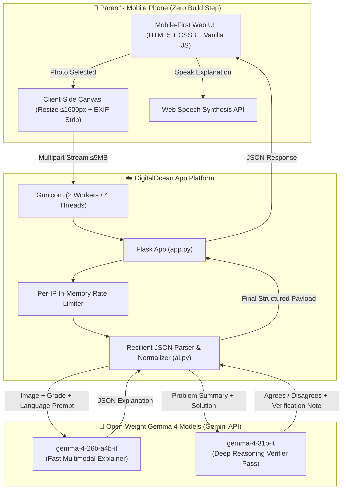

# LevelUp 🚀

> **"Your kid's homework. Your language. Level up."**

A parent photographs their child's homework and gets a crystal-clear explanation in their own mother tongue, plus an intuitive step-by-step script to teach it without frustration, and a 3-tier progressive hint ladder for the child.

Built for **Hacktoberfest 2026 — Build with Gemma 4 (MLH x DigitalOcean)**.

---

## 🌟 The Problem

Millions of parents never had the opportunity to study in English or beyond primary school. Yet every evening, their children bring home homework in English or at an academic level the parents cannot explain.

- **Tuition is expensive** and out of reach for working-class families.
- **Parents feel helpless**, guilty, and disconnected from their child's education.
- **Children fall behind** or resort to copying final answers without understanding.

**LevelUp** bridges this gap. Any parent with an affordable smartphone can photograph a textbook or worksheet and immediately understand the core concept in their native language—empowering them to be their child's first and best tutor.

---

## 📱 Live Demo & Key Highlights

- **Languages:** English, हिन्दी (Hindi), தமிழ் (Tamil), తెలుగు (Telugu), বাংলা (Bengali), मराठी (Marathi).
- **Target Grades:** Classes 3 through 8 (Ages ~8–14).
- **Zero-Storage Privacy:** Student photos are processed strictly in-memory and discarded. EXIF metadata is stripped client-side.
- **Dual Gemma 4 Engine:** Multimodal explanation powered by `gemma-4-26b-a4b-it`; mathematical and scientific verification double-checked independently by `gemma-4-31b-it`.
- **LevelUp Hint Ladder:** Instead of spoon-feeding answers, hints unlock in stages:
  - **⭐ Level 1 · Nudge:** A guiding question to spark thinking.
  - **🔓 Level 2 · Bigger hint:** The next logical step without spoiling the solution.
  - **🏆 Level 3 · Full solution:** Complete worked solution, safeguarded behind a conscious confirmation step.
- **✍️ Check My Child's Work:** Second mode allows photographing the child's handwritten attempt for constructive, encouraging feedback that never shames.
- **🎯 Practice Questions:** Generates similar questions with interactive tap-to-reveal answers to reinforce mastery.
- **🔊 Read Aloud:** Built-in Web Speech API voice reader for parents who prefer listening.

---

## 🎨 Warm, Accessible Design System

LevelUp features a warm **Olive Green & Beige** palette inspired by natural chalkboards, organic notebooks, and home study desks—intentionally avoiding cold, robotic "AI wrapper" aesthetics:

| Palette Token | Color | Semantic Purpose |
|---|---|---|
| **Deep Olive** | `#4A5D3A` | Primary actions, branding, key headers |
| **Meadow Olive** | `#6B8F5B` | Interactive pills, links, accents |
| **Warm Beige** | `#F5F0E8` | Relaxing, paper-like page background |
| **Soft Cream** | `#FFFDF7` | High-contrast input cards and surfaces |
| **Earthy Brown** | `#5C4A3A` | Warm, readable typography |
| **Warm Terracotta** | `#C67B5C` | Friendly warnings and retake prompts |
| **Harvest Gold** | `#D4A54A` | Level badges, stars, and highlights |

Supports **auto-adaptive dark mode** via `prefers-color-scheme` with deep olive tones.

---

## 🏛️ System Architecture



---

## 💡 Why Open-Weight Models (Gemma 4)?

1. **Child Data Privacy:** Open-weight models can be hosted entirely on private infrastructure (e.g., a DigitalOcean GPU Droplet) so student worksheets and handwritten notes never leave the school or family's legal perimeter.
2. **Affordability for Public Schools & NGOs:** Proprietary closed-source APIs become cost-prohibitive at municipal scale. Open weights allow self-hosting, batch inference, and local quantizations.
3. **No Vendor Lock-in:** Educational institutions remain in sovereign control of their fine-tunes, curriculum alignments, and deployments.
4. **Dual Model Synergy:** We combine the agility of `gemma-4-26b-a4b-it` for fast multimodal translation and explanation with the larger capacity of `gemma-4-31b-it` for rigorous answer verification.

---

## 🚀 Running Locally

### Prerequisites
- Python 3.12+ (tested up to 3.14)
- Google Gemini API key with Gemma 4 access ([Google AI Studio](https://aistudio.google.com/apikey))

### Quickstart

1. **Clone the repository:**
   ```bash
   git clone https://github.com/your-username/levelup.git
   cd levelup
   ```

2. **Create a virtual environment & install dependencies:**
   ```bash
   python -m venv .venv
   source .venv/bin/activate  # On Windows: .venv\Scripts\activate
   pip install -r requirements.txt
   ```

3. **Configure environment variables:**
   ```bash
   cp .env.example .env
   ```
   Edit `.env` to add your `GEMINI_API_KEY`:
   ```ini
   GEMINI_API_KEY=AIzaSy...your_actual_key...
   PORT=8080
   ```

4. **Run the test suite:**
   ```bash
   pytest
   ```

5. **Start the application:**
   ```bash
   python app.py
   ```
   Open `http://localhost:8080` in your browser (or use responsive mode in DevTools for the mobile experience).

---

## 🚢 Deploying to DigitalOcean App Platform

LevelUp is configured out-of-the-box for **DigitalOcean App Platform**:

1. **Push your code to GitHub:**
   ```bash
   git add .
   git commit -m "feat: levelup hackathon release"
   git push origin main
   ```

2. **Create App in DigitalOcean:**
   - Go to [DigitalOcean Control Panel](https://cloud.digitalocean.com/apps) → **Create App**.
   - Select **GitHub** and authorize your `levelup` repository.
   - DigitalOcean auto-detects `runtime.txt` (`python-3.12.13`) and `.do/app.yaml`.

3. **Configure Environment Variables:**
   - Add `GEMINI_API_KEY` as an **Encrypted Secret**.
   - Verify health check path is `/healthz`.

4. **Deploy:**
   - Click **Deploy**. In under 3 minutes, your public URL will be live!

---

## 🎤 60–90 Second Hackathon Demo Pitch

- **[0:00–0:15] The Hook:** *"300 million parents in India alone cannot help their kids with tonight's homework—not because they don't care, but because the syllabus is in English or beyond their schooling. Tuition is a luxury. Meet LevelUp."*
- **[0:15–0:40] Live Interaction:** *"I select Hindi, Grade 5 Math, and snap a picture of this fractions word problem. In seconds, LevelUp translates the core concept into simple everyday language about dividing rotis and coins, giving the parent an exact 3-step teaching script."*
- **[0:40–0:55] Hint Ladder & Voice:** *"Instead of spoiling the answer, LevelUp provides a hint ladder. Level 1 nudges. Level 2 guides. Level 3 unlocks only with confirmation. Listen to it in Hindi using the Listen button."*
- **[0:55–1:15] Trust & Gemma 4:** *"Notice the 'Double-checked' badge. A larger Gemma 4 model independently solved the problem from scratch to verify the math before presenting it. And in our second tab, parents can even check their child's handwritten work for gentle encouragement."*
- **[1:15–1:30] Conclusion:** *"Built on open-weight Gemma 4 and DigitalOcean. Zero photos stored. Every parent can level up!"*

---

## 🛡️ Responsible AI & Ethical Design

- **Not a Teacher Replacement:** The app footer clearly advises parents to double-check important questions with school teachers.
- **Privacy by Default:** Zero tracking cookies, zero analytics cookies, and zero database persistence. Images exist solely in RAM during execution.
- **Encouragement First:** Check mode feedback is programmed to highlight what the child got right before gently explaining the misunderstanding.

---

## 🗺️ Roadmap

- [x] Multilingual explainer (6 Indic languages)
- [x] Verification pass with dual Gemma 4 models
- [x] Read-aloud text-to-speech integration
- [x] Check my child's work mode
- [x] Practice question generator
- [ ] DigitalOcean GPU Droplet self-hosting guide using vLLM/Ollama
- [ ] WhatsApp bot integration via Twilio / Gupshup for ultra-low bandwidth reach
- [ ] Teacher worksheet generator link for shared community classrooms

---

## 📄 License

MIT License. Built with ❤️ for Hacktoberfest 2026.
